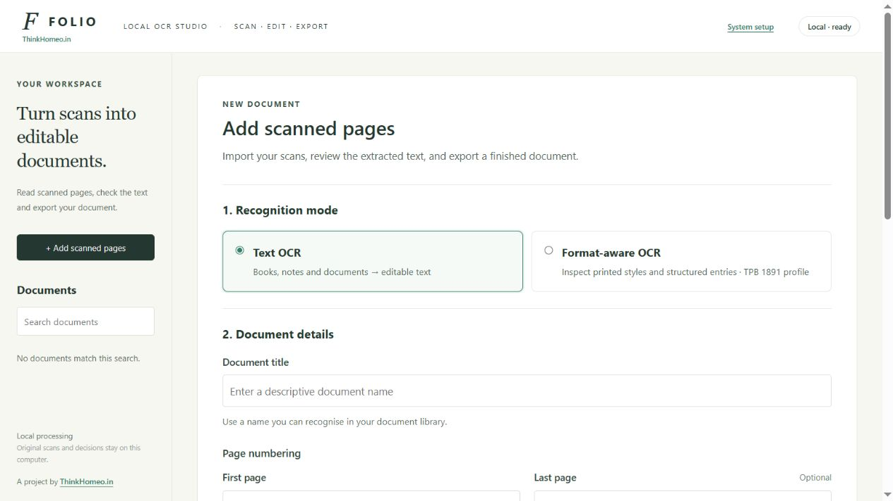
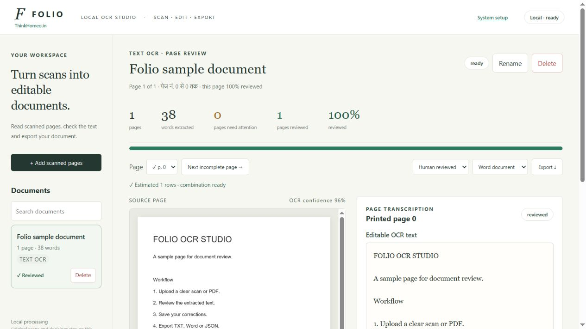

# Folio OCR Studio

### Hindi & English OCR · PDF to Text · Scan Review · Document Export

[](https://www.python.org/)
[](https://github.com/tesseract-ocr/tesseract)
[](https://thinkhomeo.in)
[](LICENSE)
[](CONTRIBUTING.md)

**Folio** is an open-source, local **OCR application for Hindi and English**
that turns scanned books, images and PDFs into editable documents. Upload
pages, compare the extracted text with the original scan, save corrections,
and export **TXT, Word (DOCX) or JSON**.

Its **Format-aware OCR** mode supports structured printed entries using the
**Boenninghausen / Allen TPB 1891 profile**, with human review and structured
JSON, CSV, SQLite and SQL exports.

> Created by **[Think Homeo (ThinkHomeo.in)](https://thinkhomeo.in)**.
> **स्कैन से संपादन योग्य दस्तावेज़ — हिन्दी और अंग्रेज़ी OCR, जाँच और निर्यात।**

[Quick start](#quick-start-on-windows) · [Screenshots](#screenshots) ·
[Features](#key-features) · [Documentation](#documentation) ·
[Troubleshooting](docs/TROUBLESHOOTING.md) · [License](#attribution-and-license)

## Why Folio?

Recognising text is only the first step in document digitization. A scan can
contain OCR mistakes, unusual page numbering or text that needs checking
before it is shared. Folio keeps the original page beside editable OCR text
and saves review decisions with the document.

- **Local OCR:** Tesseract recognition and document storage stay on your computer.
- **Hindi and English:** choose Hindi, English, or English + Hindi language data.
- **A review workflow:** check, correct and save each page before exporting.
- **Readable documents:** export page-aware TXT, Word documents or JSON evidence.
- **Visible dependency status:** see what is ready, missing or not yet checked.

Internet is needed for initial installation and downloads. OCR works locally
after the required packages and language data are installed.

## Screenshots

**Upload workspace — recognition mode, document details and source files**



**Page review — compare the original scan with editable OCR text**



These screenshots use a separate workspace and synthetic sample content.
They show the application interface; they are not an OCR accuracy benchmark.

## Key features

| Feature | What it does |
| --- | --- |
| **Hindi / Devanagari OCR** | Recognises Hindi printed text using Tesseract `hin` data |
| **English and mixed-language OCR** | Offers `eng`, `hin` and `eng+hin` recognition |
| **PDF and image ingestion** | Accepts PNG, JPEG, WEBP, TIFF, JP2 and PDF |
| **Multipage documents** | Reads PDF/TIFF pages and keeps source files |
| **Printed page numbering** | Supports page zero; calculates the last number when blank |
| **Editable page review** | Shows scans beside text; saves reviewer, note and edit history |
| **Document management** | Search, open, rename and delete completed documents |
| **Export preflight** | Checks scope, format compatibility and exportable row count |
| **Windows Setup wizard** | Checks Python, packages, OCR engine, language data and models |
| **TPB format-aware review** | Reviews remedies, rubrics and printed grades for the TPB 1891 profile |

### Choose the right OCR mode

| Mode | Recommended use | Export formats |
| --- | --- | --- |
| **Text OCR** — default | General printed books, notes and documents | TXT, Word (DOCX), JSON |
| **Format-aware OCR** | Printed entries matching the current TPB 1891 profile | JSON, CSV, reviewed SQLite and SQL |

Format-aware OCR is edition-specific. It does not imply general table, form
or arbitrary typeface recognition. Text OCR does not require classifier models.

## Quick start on Windows

### 1. Get the source

Download **Code → Download ZIP** from
[the repository](https://github.com/ThinkHomeo/folio-ocr-studio) and extract it,
or clone it:

```powershell
git clone https://github.com/ThinkHomeo/folio-ocr-studio.git
cd folio-ocr-studio
```

### 2. Check and install dependencies

Double-click **setup_folio.bat**.

If Python is missing, install **Python 3.10 or newer, 64-bit** from
[python.org](https://www.python.org/downloads/windows/), select
**Add Python to PATH**, then open Setup again.

Use the Setup screen to install app packages, Tesseract and English/Hindi
language data. It shows progress, logs, failed states and retry options.

### 3. Open Folio

When required checks are ready, choose **Start Folio → Open Folio**.
For later sessions, double-click **run_app.bat** and keep its command window open.

| Service | Default local address |
| --- | --- |
| Folio application | [http://127.0.0.1:8788/](http://127.0.0.1:8788/) |
| Standalone Setup | [http://127.0.0.1:8790/](http://127.0.0.1:8790/) |

To use another app port:

```powershell
.\run_app.bat --app-port 8791
```

**हिन्दी में installation:** ZIP निकालें → **setup_folio.bat** चलाएँ →
ज़रूरी dependencies install करें → **Start Folio → Open Folio** चुनें।
अगली बार **run_app.bat** चलाएँ। आपकी कॉपी किसी दूसरे port पर चल रही हो तो
Setup में दिखाया गया **Open Folio** link इस्तेमाल करें।

Detailed instructions: [Installation guide](docs/INSTALLATION.md).

## Scan, review and export

1. **Prepare the source.** Use clear original scans, preferably around 300 DPI.
2. **Add scanned pages.** Select Text OCR or the TPB format-aware profile.
3. **Name and number the document.** Enter a title and the first printed page number.
4. **Choose the OCR language and layout.** For general pages, start with Automatic.
5. **Run OCR.** Wait for processing to finish before saving reviews or exporting.
6. **Review each page.** Compare with the scan, correct text and save with a reviewer name.
7. **Export.** Choose Draft or Human reviewed scope and a compatible output format.

The full workflow, including token corrections and review shortcuts, is in
[APPLICATION.md](APPLICATION.md).

### Example: a Hindi book scan

Choose **Text OCR → Hindi → Automatic**. Enter the first printed page number
and leave Last page blank. Upload the scans in document order, correct the
Devanagari text, then export a Word document.

For printed pages containing both Hindi and English, choose **English + Hindi**.
Hindi recognition requires the Hindi language pack even if the interface
labels are in English.

### Example: page numbering from zero

Three uploaded scans with **First page = 0** and an empty Last page receive
labels **0, 1, 2**. Page numbering labels every uploaded page; it does not select
a PDF subset. A mismatched expected last page produces a notice and keeps all scans.

### Example: TPB 1891 structured entries

Choose **Format-aware OCR**, use the appropriate printed source, and review
remedy identity, rubric and grade. The profile maps parentheses to grade 1,
roman to 2, italic to 3, antique/bold to 4 and capitals to 5. Trusted classifier
models can be supplied in `out/`; missing or uncertain evidence needs review.

## Export formats

| Output | Text OCR | Format-aware OCR |
| --- | --- | --- |
| **TXT** | Page text with page boundaries | — |
| **Word / DOCX** | Editable document with page breaks | — |
| **JSON** | Text, source references and review evidence | Structured entries and evidence |
| **CSV** | — | Structured entry rows |
| **SQLite / SQL** | — | Human reviewed entries with provenance |

**Draft** includes extracted content. **Human reviewed** includes saved reviews.
Save your latest corrections before exporting. Reviewed status records a
human decision; it does not guarantee that the source was transcribed perfectly.

## System requirements

| Component | Requirement |
| --- | --- |
| Operating system | Windows for the batch launchers and automatic Setup installation |
| Python | 3.10 or newer, 64-bit |
| OCR engine | Tesseract 5+ |
| Languages | English `eng`; Hindi `hin` when needed |
| Python packages | Declared in [pyproject.toml](pyproject.toml) and installed by Setup |
| Optional TPB classifiers | Trusted `mlp_model.pkl` and `shape_model.pkl` |
| Node.js | 22+ for developer UI tests only |

The project is a Python browser application, not a standalone EXE.
Upload limits are 100 files, 500 MB total, 500 pages and 90 megapixels per page.
PDF pages render at 300 DPI.

## Configuration and portability

| Need | How to configure it |
| --- | --- |
| Another app port | `run_app.bat --app-port 8791` |
| Another Setup port | `setup_folio.bat --port 8792` |
| Another document folder | `run_app.bat --data-dir "YOUR-FOLDER"` |
| Another Tesseract location | `TESSERACT_CMD` or app `--tess PATH` |
| Optional format-aware models | App `--models PATH` or `FORMAT_OCR_MODELS` |
| Legacy BBCR translation reference | `BBCR_HI_PATH` for research scripts only |

A fresh installation uses **app-data/**. The Windows launcher uses
**dev-data/** when that existing folder is present. To move saved work, stop
the old server and copy the complete data folder separately. Recreate the
virtual environment on the destination computer.

User documents, scans, databases, logs, models and environments are excluded
from Git and the source archive. See [Installation and transfer](docs/INSTALLATION.md)
and [optional model notes](out/README.md).

## Frequently asked questions

**Does Folio send scans to a cloud OCR service?**

The recognition workflow uses local Tesseract and stores documents locally.
Installation downloads packages and language packs from their respective sources.

**Can it convert a scanned PDF to editable text or Word?**

Yes. Use Text OCR, review the extracted pages, then export TXT, DOCX or JSON.

**Are handwritten pages and all document layouts supported?**

The workflow targets printed text. Handwriting, complex tables and difficult
layouts need separate validation and may require substantial manual correction.

**Can GitHub Pages run the app?**

GitHub Pages serves static files; Folio needs its Python server and Tesseract.
Download it and run Setup locally.

**Why is a package installed on my computer still missing in Setup?**

Packages belong to individual Python environments. Setup reports the active
Folio environment when it can identify one; an uncreated local environment is
shown separately. See [Troubleshooting](docs/TROUBLESHOOTING.md).

## Development and testing

```powershell
python -m venv .venv
.\.venv\Scripts\python.exe -m pip install -e ".[test]"
.\.venv\Scripts\python.exe -m unittest discover -s tests -v
node --test tests/test_review_ui.cjs tests/test_setup_ui.cjs
python tools/prepare_github.py
```

The Python tests use temporary workspaces, generated inputs and mocked OCR.
UI controller tests run offline. GitHub Actions configuration is included in
[.github/workflows/checks.yml](.github/workflows/checks.yml); it must be uploaded
at that exact path to run. These checks do not replace browser rendering tests
or an independent OCR benchmark.

Contribution instructions: [CONTRIBUTING.md](CONTRIBUTING.md).

## Documentation

| Guide | What you will find |
| --- | --- |
| [Application guide](APPLICATION.md) | Upload, page/token review, shortcuts and export |
| [Installation guide](docs/INSTALLATION.md) | Windows Setup, manual install, configuration and transfer |
| [Troubleshooting](docs/TROUBLESHOOTING.md) | Dependency, language, port, upload and export issues |
| [Keywords and GitHub topics](docs/KEYWORDS.md) | Relevant English/Hindi terms and repository About settings |
| [GitHub upload guide](docs/GITHUB_UPLOAD.md) | Upload instructions in Hindi |
| [Contributing](CONTRIBUTING.md) | Development setup and meaningful verification |
| [Research notes](docs/RESEARCH.md) | Historical TPB prototype notes |
| [Architecture review](ARCHITECTURE_REVIEW.md) | Historical assessment and future work |

`formatocr/` contains the local app and UI. `tpbocr/` contains the TPB engine
and legacy research tools. External research datasets are not included.

Future work includes independent held-out evaluation, more recognition profiles,
resumable OCR and a standalone installer. These are roadmap items, not current features.

## Attribution and credits

Folio OCR Studio is a project by **[Think Homeo (ThinkHomeo.in)](https://thinkhomeo.in)**.

If you share, adapt or describe Folio, a link to
**[https://thinkhomeo.in](https://thinkhomeo.in)** is appreciated. This request
for a visible backlink is separate from the MIT License's notice requirements.

Recognition uses [Tesseract OCR](https://github.com/tesseract-ocr/tesseract),
with the local app built using Python and FastAPI. Third-party packages and
reference-data provenance are described in [NOTICE.md](NOTICE.md).

## Attribution and license

This project is open-source software licensed under the [MIT License](https://github.com/ThinkHomeo/folio-ocr-studio/blob/main/LICENSE).

Copyright (c) 2026 **Think Homeo** ([https://thinkhomeo.in](https://thinkhomeo.in)).

See [NOTICE.md](NOTICE.md) for attribution and the existing reference-data
provenance. Third-party materials retain their respective rights and licenses.
